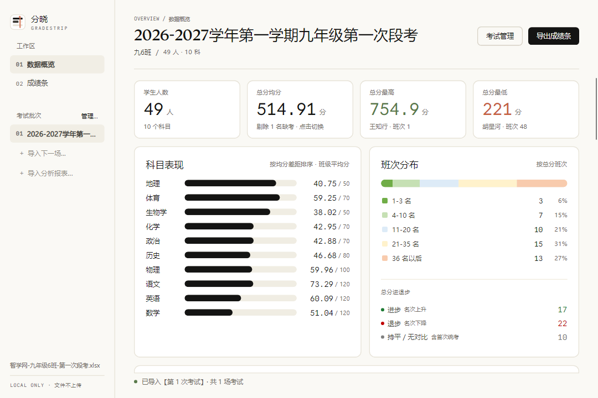
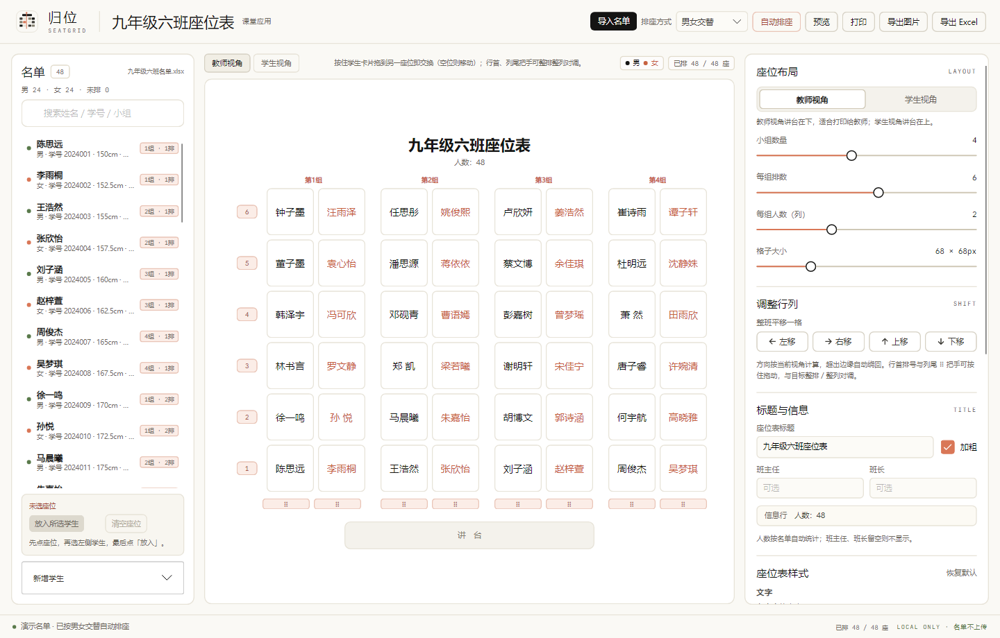
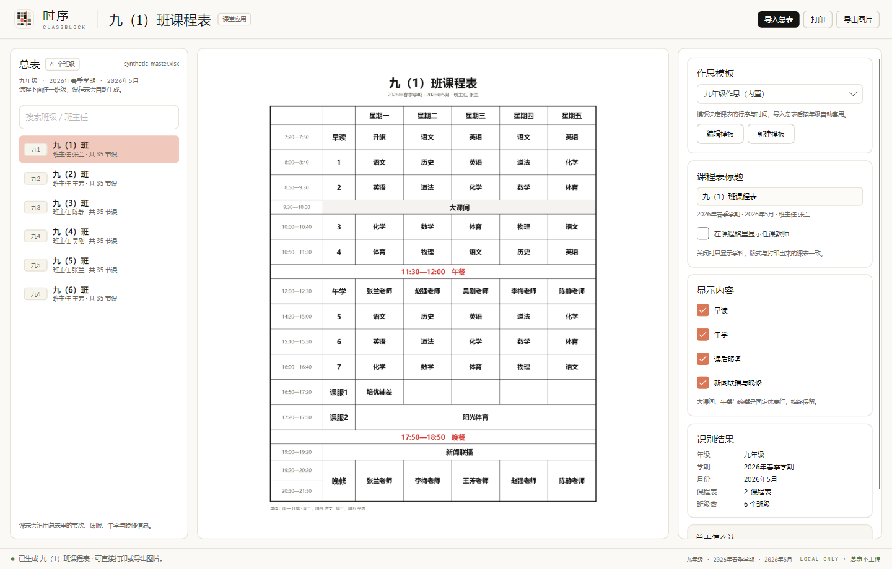
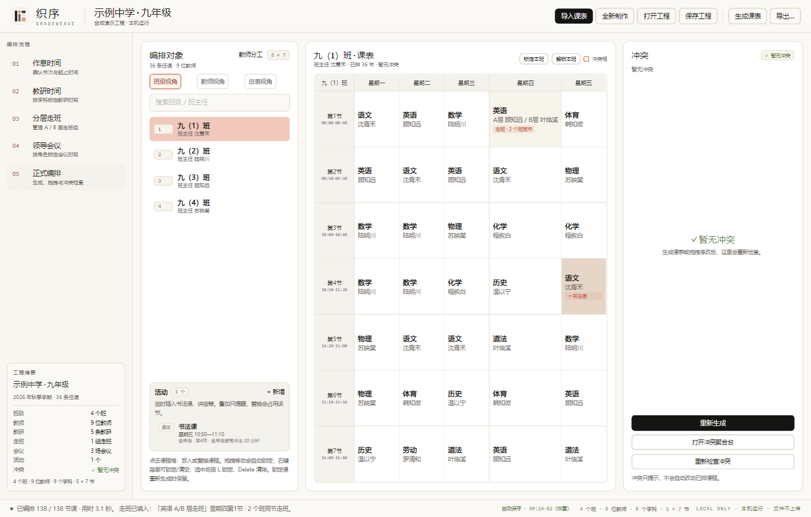
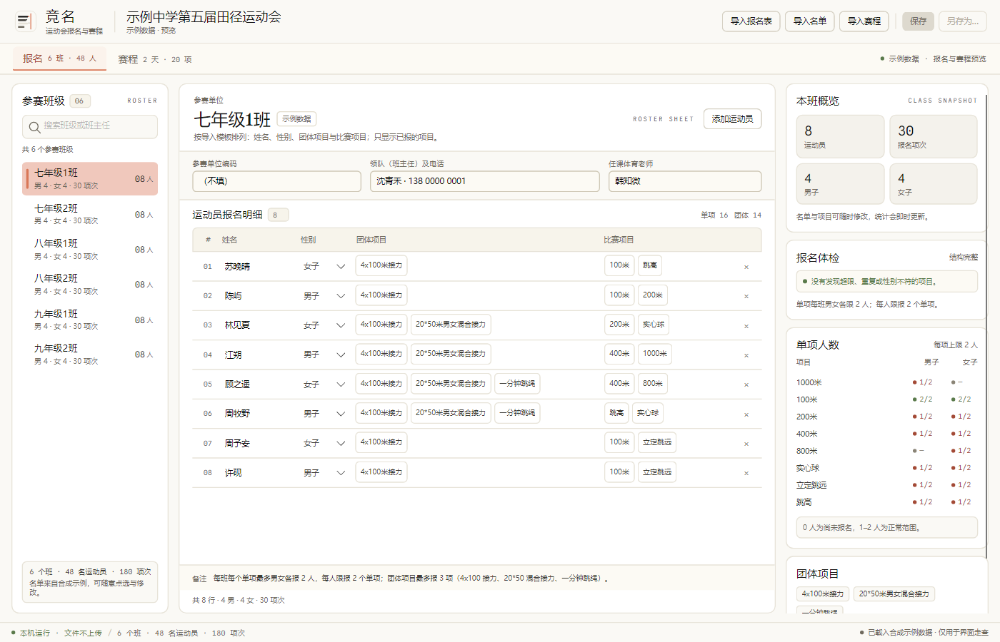
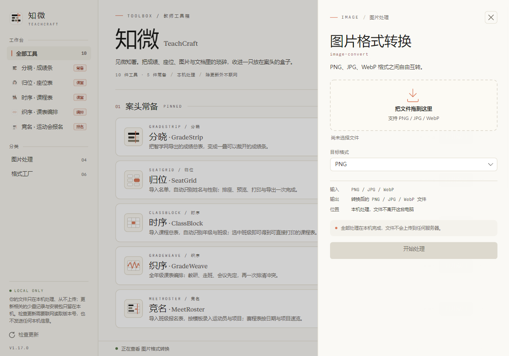

# 知微 · TeachCraft

<p align="center">
  
</p>

<p align="center">
  面向教师的本地工具箱：把成绩、座位、课表、图片与文档的琐碎，收进一只放在案头的盒子。
</p>

<p align="center">
  <a href="https://github.com/SECTL/TeachCraft/releases/latest">下载</a> ·
  <a href="#五件常备应用">常备应用</a> ·
  <a href="#十件小工具">十件小工具</a> ·
  <a href="#本地优先">本地优先</a>
</p>

---

**10 件图片 / PDF 小工具**，加上 **5 件常备应用**：分晓成绩条、归位座位表、时序课程表、织序课表编排、竞名运动会报名。统一使用分晓的纸墨设计语言，**所有文件处理都在本机完成，从不上传**。

技术栈：C# / .NET 10 + Avalonia 12，支持 Windows、macOS、Linux。


---

## 五件常备应用

### 分晓 · GradeStrip — 成绩条生成器

把智学网导出的成绩总表放进来，自动识别「班级全学科成绩汇总」，一步生成可打印的个人成绩条。自带班级概览、学科表现对比、名次进退与班次分布。



### 归位 · SeatGrid — 座位表生成器

导入名单，自动识别姓名与性别；排座、预览、打印与导出一次完成。支持按名单顺序 / 随机 / 身高 / 视力排座，同桌可异性交替或同性成对，学生视角是教师视角的真正 180° 旋转。导出的 Excel 可以再导回来接着改。



### 时序 · ClassBlock — 课程表生成器

导入学校的课程总表，自动识别年级、学期与全部班级；选中班级即可得到可直接打印的课程表。作息由模板驱动——早读、大课间、午学、课后服务、晚修的位置与时间都能改，改完存成自己的模板。



### 织序 · GradeWeave — 全年级课表编排

全年级课表编排：教研、走班、会议先定，再一次排清冲突。支持分层走班（自动挑时段）、临时活动占位、手动放课、锁课与冲突聚合台。导出 Excel（软件自带 / 参考校双样式）、PNG 或 PDF。



### 竞名 · MeetRoster — 运动会报名与赛程

导入班级报名表，按模板录入运动员与项目；赛程表按日期与项目速览。内置报名体检——单项男女各限 2 人、每人限 2 个单项，只在真正违规时才提示。



---

## 十件小工具

| 图片处理 | 格式工厂 |
| :--- | :--- |
| 图片格式转换 | PDF 转 Word |
| 图片尺寸调整 | Word 转 PDF |
| 图片压缩 | 图片合成 PDF |
| 图片加水印 | PDF 转图片 |
| | PDF 合并 |
| | PDF 拆分提取 |

点开任意一件，右侧抽屉里是它的全部选项；所有处理都在本机完成。



---

## 本地优先

- **文件不上传**：所有图片、PDF、表格的处理都在本机完成，没有任何上传、账号或遥测。
- **唯一联网的地方是「检查更新」**：只向 GitHub Releases 读取版本号，不发送任何本机信息。打开更新页本身不联网，需要你在页内再点一次。
- **更新相关的记录与安装包只留在本机**（`TeachCraft\Update` 目录）。


---

## 下载

到 [Releases](https://github.com/SECTL/TeachCraft/releases) 下载对应平台的包：

| 平台 | 推荐 | 说明 |
| :--- | :--- | :--- |
| Windows | `*-win-x64-sc-Setup.exe` | 安装版，自带运行时；也有 `fdd` 版（体积小，需装 .NET 运行时） |
| Windows | `*-win-x64-sc.zip` | 绿色免安装版，解压即用 |
| macOS | `*.dmg` | 拖进「应用程序」即可；未做公证，首次打开需右键 →「打开」 |
| Linux | `*-linux-x64-sc.zip` | 解压后运行 `TeachCraft` |

架构上还提供 `win-x86` / `win-arm64` / `osx-x64` / `osx-arm64` / `linux-arm64`；`linux-arm`（32 位）暂不支持，因为 PDF 排版引擎缺少该架构的原生库。

安装版与绿色版都能用「检查更新」升级——程序会按当前安装方式自动挑选对应的安装包。

---

## 从源码构建

需要 .NET 10 SDK。

```bash
git clone https://github.com/SECTL/TeachCraft.git
cd TeachCraft
dotnet build TeachCraft.slnx -c Release
dotnet run --project src/TeachCraft.App
```

跑测试：

```bash
dotnet test tests/TeachCraft.Tests/TeachCraft.Tests.csproj -c Release
dotnet test tests/GradeStrip.Tests/GradeStrip.Tests.csproj -c Release
dotnet test tests/GradeWeave.Tests/GradeWeave.Tests.csproj -c Release
```

打包单个平台：

```bash
dotnet publish src/TeachCraft.App/TeachCraft.App.csproj \
  -c Release -r win-x64 --self-contained true \
  -p:PublishSingleFile=true -p:IncludeNativeLibrariesForSelfExtract=true \
  -o dist/TeachCraft-win-x64-sc
```

版本号只在 `Directory.Build.props` 里维护；发布流程见 [AGENTS.md](AGENTS.md) 第三节。

---

## 文档

- [AGENTS.md](AGENTS.md) — 版本号规范、CI/CD 契约、仓库结构与编码准则
- [.memory/](.memory/) — 项目记忆：架构、决策、踩坑记录

---

## 隐私

本仓库公开托管。所有截图、演示数据与测试 fixture 均为**合成数据**（示例中学、虚构师生姓名），不包含任何真实的师生信息。真实数据只在你自己的电脑上流转。
