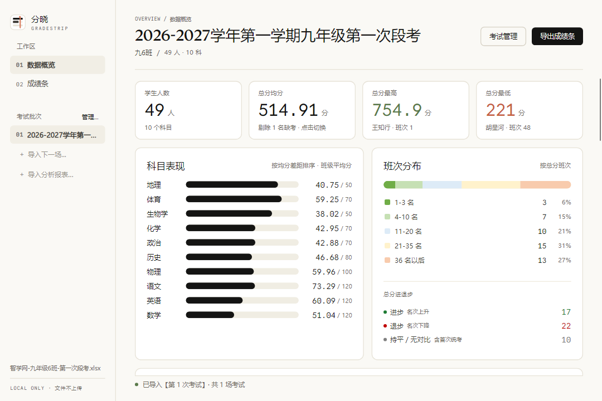
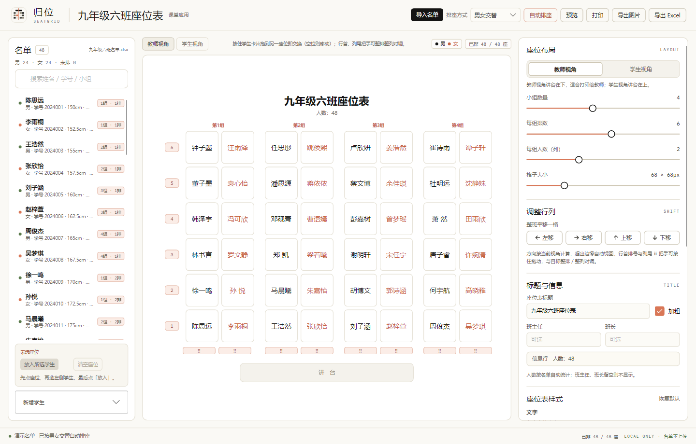
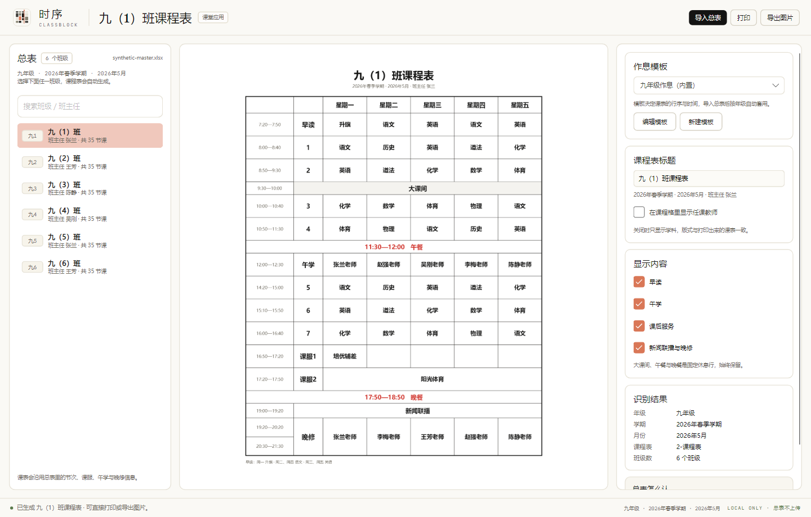
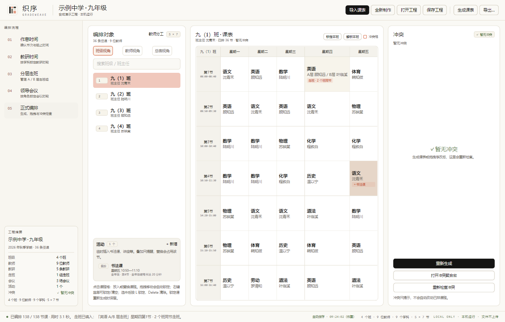
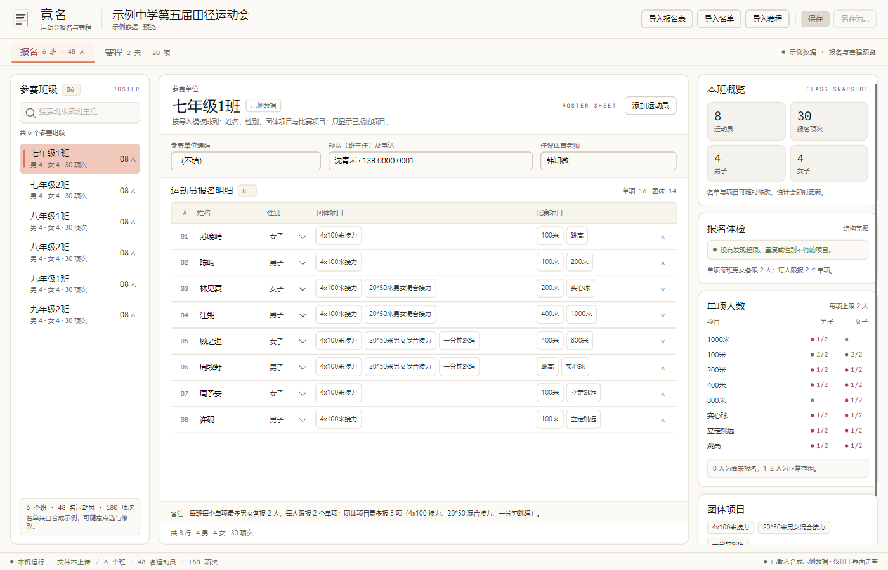
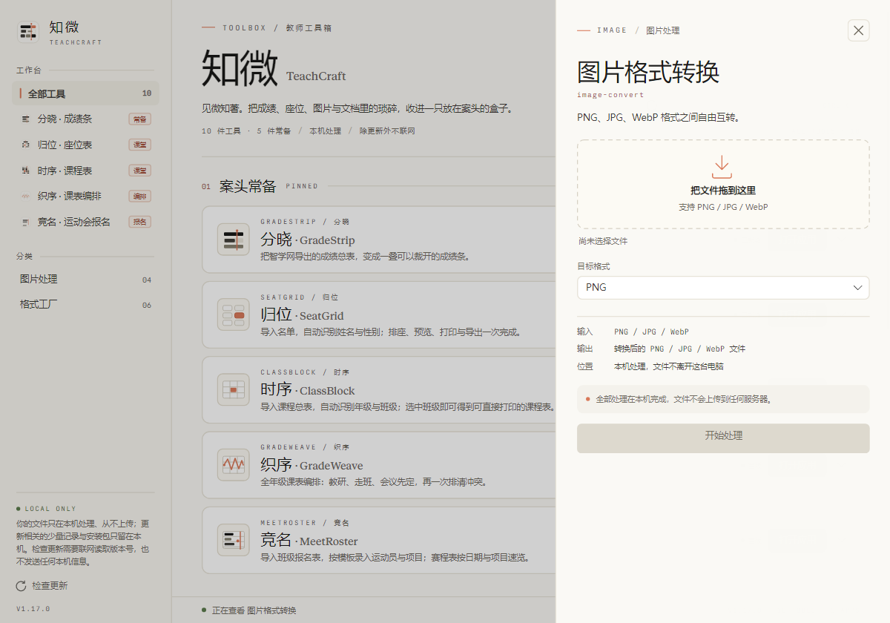
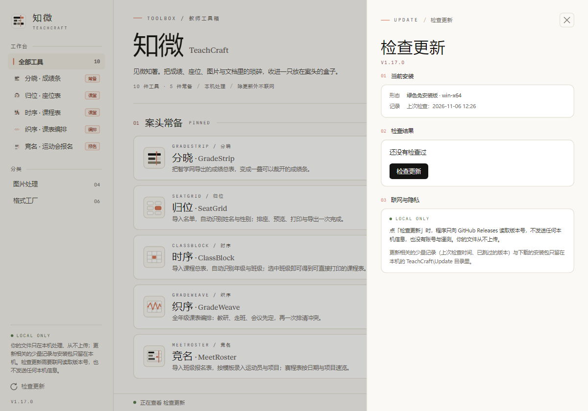

# 知微 · TeachCraft

<p align="center">
  
</p>

<p align="center">
  面向教师的本地工具箱：把成绩、座位、课表、图片与文档的琐碎，收进一只放在案头的盒子。
</p>

<p align="center">
  <a href="https://github.com/SECTL/TeachCraft/releases/latest">下载</a> ·
  <a href="#六件常备应用">常备应用</a> ·
  <a href="#十四件小工具">十四件小工具</a> ·
  <a href="#本地优先">本地优先</a>
</p>

---

**14 件图片 / PDF / 表格小工具**，加上 **6 件常备应用**：分晓成绩条、归位座位表、时序课程表、织序课表编排、竞名运动会报名、辑册作业归档。统一使用分晓的纸墨设计语言，文件默认在本机处理。

技术栈：C# / .NET 10 + Avalonia 12，支持 Windows、macOS、Linux。


---

## 六件常备应用

### 分晓 · GradeStrip — 成绩条生成器

把智学网导出的成绩总表放进来，自动识别「班级全学科成绩汇总」，一步生成可打印的个人成绩条。自带班级概览、学科表现对比、名次进退与班次分布。



### 归位 · SeatGrid — 座位表生成器

导入名单，自动识别姓名与性别；排座、预览、打印与导出一次完成。支持按名单顺序 / 随机 / 身高 / 视力排座，同桌可异性交替或同性成对，学生视角是教师视角的真正 180° 旋转。导出的 Excel 可以再导回来接着改。



### 时序 · ClassBlock — 课程表生成器

导入学校的课程总表，自动识别年级、学期与全部班级；选中班级即可得到可直接打印的课程表。作息由模板驱动——早读、大课间、午学、课后服务、晚修的位置与时间都能改，改完存成自己的模板。



### 织序 · GradeWeave — 全年级课表编排

全年级课表编排：教研、走班、会议先定，再一次排清冲突。支持分层走班（自动挑时段）、临时活动占位、手动放课、锁课与冲突聚合台。导出 Excel（软件自带 / 参考校双样式）、PNG 或 PDF。



### 竞名 · MeetRoster — 运动会报名与赛程

导入班级报名表，按模板录入运动员与项目；赛程表按日期与项目速览。内置报名体检——单项男女各限 2 人、每人限 2 个单项，只在真正违规时才提示。



### 辑册 · WorkFolio — 扫描作业按学生归档

导入扫描的作业页（图片或多页 PDF，自动拆页）与班级名单（Excel 或直接粘贴），逐张把页匹配给学生；识别不了的进入待处理列表，人工点选即可。可设每人应交页数：交齐的学生移入「已匹配」，缺页的显示「缺 N 页」，已匹配的页可逐页或整人撤回。支持混班，按班级分文件夹导出：改名归档、每人合并一份 PDF、归档并生成 Excel 索引，或只分文件夹保留原文件名。原始文件只读，导出不覆盖导入来源。1.42.0 起可生成智学网式 A4 学号填涂模板，扫描后在预览上框选数字格一键识别，按学号唯一匹配，只把读不出或跨班重复的页留在待处理；全程本机完成，不引入 OCR 或二维码。1.43.0 起支持「扫描任务」：Windows 可直接用 WIA 驱动复印机扫描，macOS / Linux 可监听收件文件夹；扫描件自动进入当前批次或新建批次。1.44.0 起扫描选项按 WIA 驱动能力显示：驱动报什么显示什么，未报告时用保守默认值。

---

## 十四件小工具

| 图片处理 | 格式工厂 | 教学工具 |
| :--- | :--- | :--- |
| 图片格式转换 | PDF 转 Word | 名单核对 |
| 图片尺寸调整 | Word 转 PDF | Excel 按班拆表 |
| 图片压缩 | 图片合成 PDF | 试卷排版 |
| 图片加水印 | PDF 转图片 | 奖状生成 |
| | PDF 合并 | |
| | PDF 拆分提取 | |

点开任意一件，右侧抽屉里是它的全部选项；所有处理都在本机完成。

**奖状生成（1.40.0）**：选择一张 PNG / JPG / WebP / BMP 底图和一份 XLSX / XLS 名单，明确指定工作表、表头行、姓名列与奖项列；不需要奖项时选择「（不印奖项）」。可在预览中拖动姓名、奖项调整位置，也可用数值控件或方向键调整，三种方式同步；字号可调，位置按底图归一化保存，预览与 PDF 共用同一套布局。按表中顺序生成一人一页的 A4 PDF，跳过空姓名，重复姓名保留。当前 PDF 因完整嵌入中日韩字体而体积较大，详见 [.memory 中的验证记录](.memory/07-验证与测试资产.md)。处理全在本机完成，输出不能覆盖底图、名单或已有同名文件。



**1.40.1 奖状界面修复**：本轮范围为姓名 / 奖项设置分组、透明定位手柄、不同预览状态的提示、列映射指引、成品访问入口、设置变更后的旧结果标记，以及处理期间关窗守卫。实测 1256 项全部通过，运行时布局 / 交互 / 导出走查通过，独立复核功能 APPROVE，视觉验收仍为 INCONCLUSIVE，详见 [验证记录](.memory/07-验证与测试资产.md)。

---

## 本地优先

- **文件处理不上传**：所有图片、PDF、表格的处理都在本机完成，没有遥测与使用统计。
- **联网只有三处，全部默认关闭、手动触发**：①「检查更新」只向 GitHub Releases 或你选定的 SECTL 镜像读取版本号，打开更新页本身不联网；②「账号与云同步」在你主动登录 SECTL 后，才手动发布或拉取共享名单与关联座位表；③「接入 SECTL 集控」是预留的设备长连接，本版本尚未实现。不开就没有任何常驻连接，也不发送任何文件。
- **云同步按字段同意**：姓名、性别、学号为必需；身高、视力、成绩、备注、原小组默认关闭，未勾选的值不会写进云端 JSON。归位可发布、拉取共享名单；辑册可拉取；分晓等其他应用后续接入。
- **凭据与记录只留本机**：账号 token 存在 `%LOCALAPPDATA%\TeachCraft\Account\`（Windows 用 DPAPI 加密），更新记录与安装包存在 `TeachCraft\Update` 目录，都不进仓库。云同步不做心跳；归位提供可选的「座位表自动同步」（默认关闭，只在改动座位或约束后上传，无定时器），其余仍是手动上传 / 拉取，也不上传原始文件。



---

## 下载

到 [Releases](https://github.com/SECTL/TeachCraft/releases) 下载对应平台的包：

| 平台 | 推荐 | 说明 |
| :--- | :--- | :--- |
| Windows | `*-win-x64-sc-Setup.exe` | 安装版，自带运行时；也有 `fdd` 版（体积小，需装 .NET 运行时） |
| Windows | `*-win-x64-sc.zip` | 绿色免安装版，解压即用 |
| macOS | `*.dmg` | 拖进「应用程序」即可；未做公证，首次打开需右键 →「打开」 |
| Linux | `*-linux-x64-sc.zip` | 解压后运行 `TeachCraft` |

架构上还提供 `win-x86` / `win-arm64` / `osx-x64` / `osx-arm64` / `linux-arm64`；`linux-arm`（32 位）暂不支持，因为 PDF 排版引擎缺少该架构的原生库。

安装版与绿色版都能用「检查更新」升级——程序会按当前安装方式自动挑选对应的安装包。

---

## 从源码构建

需要 .NET 10 SDK。

```bash
git clone https://github.com/SECTL/TeachCraft.git
cd TeachCraft
dotnet build TeachCraft.slnx -c Release
dotnet run --project src/TeachCraft.App
```

跑测试：

```bash
dotnet test tests/TeachCraft.Tests/TeachCraft.Tests.csproj -c Release
dotnet test tests/GradeStrip.Tests/GradeStrip.Tests.csproj -c Release
dotnet test tests/GradeWeave.Tests/GradeWeave.Tests.csproj -c Release
```

打包单个平台：

```bash
dotnet publish src/TeachCraft.App/TeachCraft.App.csproj \
  -c Release -r win-x64 --self-contained true \
  -p:PublishSingleFile=true -p:IncludeNativeLibrariesForSelfExtract=true \
  -o dist/TeachCraft-win-x64-sc
```

版本号只在 `Directory.Build.props` 里维护；发布流程见 [AGENTS.md](AGENTS.md) 第三节。

---

## 文档

- [AGENTS.md](AGENTS.md) — 版本号规范、CI/CD 契约、仓库结构与编码准则
- [.memory/](.memory/) — 项目记忆：架构、决策、踩坑记录

---

## 隐私

本仓库公开托管。所有截图、演示数据与测试 fixture 均为**合成数据**（示例中学、虚构师生姓名），不包含任何真实的师生信息。真实数据只在你自己的电脑上流转。
